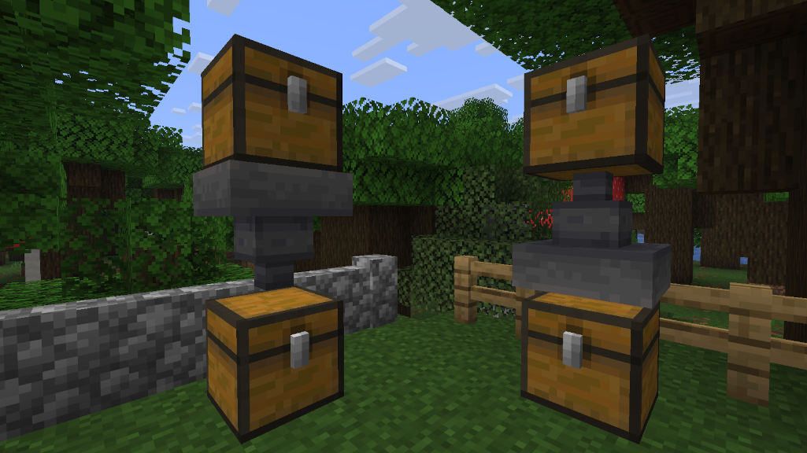

# Hopper Upper

A Fabric mod that lets hoppers be placed pointing up.

## How It Works

Place a hopper while targeting the **bottom face** of a block (looking up) and it becomes an upward hopper. No separate item or recipe needed.

- Place hopper targeting bottom face → Upward Hopper
- Place hopper targeting any other face → Normal Hopper
- Breaking an upward hopper drops a regular hopper

## Learning It

Hoppers go down. Everyone knows hoppers go down, which is exactly why nobody tries pointing one up, and why this mod can sit installed for a year unnoticed.

With [village-quests](https://github.com/fatlard1993/village-quests) installed, a farmer who has carried grain up a ladder every harvest of their life asks you to build them something that lifts instead.

## Features

- **No new item** - uses the vanilla hopper item, no crafting needed
- Full hopper functionality:
  - 5-slot inventory with hopper GUI
  - Redstone control (disable with a signal)
  - Item entity collection from below
  - Comparator output support
  - Waterlogging
- Stacks held in it are capped at vanilla's 64, even where a stack-size mod has lifted the limit elsewhere

## Behavior

The Upward Hopper reverses normal hopper behavior:
- **Pulls items from below** (block or item entities)
- **Pushes items upward** to the block above

Useful for item elevators and vertical item transport.

## Pandorical

It registers the Upward Hopper's block and item, and their models and textures, through Pandorical's content sync, so connecting clients render it without a hopper-upper jar of their own.

**The Pandorical mod must be installed on the server and client-side.** The Upward Hopper is a real registered block, so a client without Pandorical cannot render it and cannot receive chunks containing one.

## Development

Installing and how the Upward Hopper is built are in [DEVELOPMENT.md](DEVELOPMENT.md).

## License

MIT, see [LICENSE](LICENSE).
